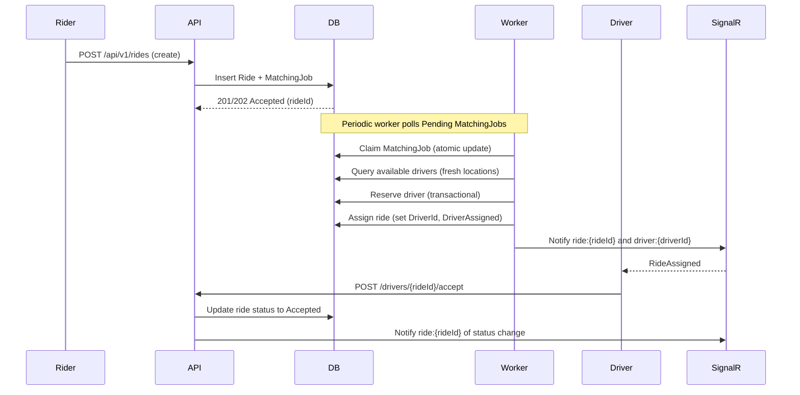
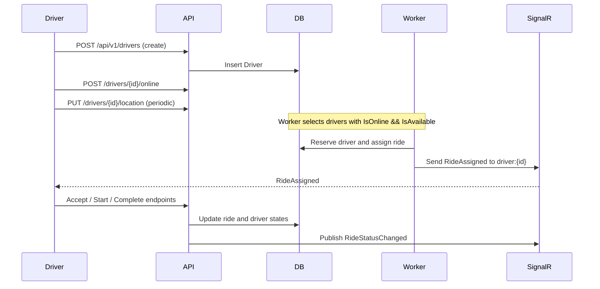

# RideMatchingSystem

This repository contains a minimal ride-matching prototype built with ASP.NET Core (.NET 10). It demonstrates a small end-to-end flow: drivers report location, riders create ride requests, a background worker matches nearby available drivers, and the system notifies participants using SignalR.

1. Project Info
----------------
- Name: RideMatchingSystem
- Purpose: Prototype a simple ride-matching service (MVP) to demonstrate realtime notifications, background processing, and basic matching logic.
- Platform: .NET 10 (ASP.NET Core)
- Projects:
  - RideMatching.Api — Web API, EF Core DbContext, SignalR hub, background worker, controllers, migrations.
  - RideMatching.Tests — Unit tests (xUnit) for utility logic (DistanceCalculator, etc.).

2. Project Structure & Architecture
----------------------------------
- RideMatching.Api
  - Controllers/
	- DriversController.cs — endpoints to create drivers, change online/offline, update location, driver actions (accept/start/complete).
	- RidesController.cs — create rides and fetch ride status.
  - Data/
	- RideDbContext.cs — EF Core DbContext configured with Driver, Ride, MatchingJob entities and indexes.
  - Entities/
	- Driver.cs, Ride.cs, MatchingJob.cs — simple POCOs representing domain entities.
  - DTOs/
	- Request and response DTOs used by controllers.
  - BackgroundJobs/
	- RideMatchingWorker.cs — hosted background service that claims MatchingJob records and performs driver assignment using optimistic atomic updates.
  - Hubs/
	- RideHub.cs — SignalR hub for driver and ride group notifications.
  - Middleware/
	- ExceptionHandlingMiddleware.cs — top-level exception handling producing consistent error responses.
  - Services/
	- DistanceCalculator.cs — utility for geospatial distance (Haversine formula).

Architecture notes:
- Layers are simple and co-located in the API project (Controllers -> DbContext -> Entities). The background worker runs inside the same process as a hosted service and uses the same DbContext factory to claim jobs and assign drivers.
- Concurrency is handled using small, atomic database ExecuteUpdateAsync statements and database transactions to reserve drivers and mark rides.
- SignalR is used to notify ride and driver groups of changes (RideMatched, RideAssigned, RideStatusChanged).

Sequence diagrams (ride & driver flow)
-------------------------------------
Below are Mermaid sequence diagrams (GitHub supports rendering Mermaid in README) and an ASCII fallback you can view in any text editor.

Ride request & matching flow (Mermaid):



Driver lifecycle flow (Mermaid):



ASCII fallback - Ride flow:

Rider -> API (create ride)
API -> DB (insert Ride + MatchingJob)
Worker -> DB (claim job)
Worker -> DB (find & reserve driver)
Worker -> DB (assign ride)
Worker -> SignalR (notify ride and driver groups)
Driver -> API (accept/start/complete)

ASCII fallback - Driver flow:

Driver -> API (create)
Driver -> API (go online)
Driver -> API (update location - periodic)
Worker -> DB (reserve & assign)
Worker -> SignalR (notify driver)
Driver -> API (accept/start/complete)

System architecture flow
------------------------
The following describes the logical components, deployment roles, and data flows for the system.

Mermaid component diagram (logical):

```mermaid
%%{init: { 'theme': 'default' }}%%
graph TD
  subgraph Client
	RiderApp[Rider App]
	DriverApp[Driver App]
  end

  subgraph APIService[RideMatching.Api]
	API[REST API (Controllers)]
	Hub[SignalR Hub]
	Worker[Background Worker]
  end

  DB[(SQL Server)]
  Cache[(Redis) - optional]
  Broker[(Message Broker) - optional]
  Observability[(Logging / Tracing / Metrics)]

  RiderApp -->|HTTP| API
  DriverApp -->|HTTP| API
  RiderApp -->|SignalR| Hub
  DriverApp -->|SignalR| Hub

  API -->|EF Core| DB
  Worker -->|EF Core| DB
  Worker -->|SignalR| Hub

  API -->|Publish events| Broker
  Worker -->|Consume/Publish| Broker
  API -->|Cache reads/writes| Cache
  Worker -->|Cache reads/writes| Cache

  API --> Observability
  Worker --> Observability
  DB --> Observability

  classDef infra fill:#f9f,stroke:#333,stroke-width:1px;
  class DB,Broker,Cache,Observability infra;
```

ASCII fallback (logical flow):

Clients (Rider/Driver) communicate with the REST API and connect to SignalR for realtime notifications. The API persists domain state in SQL Server (via EF Core). A Background Worker processes MatchingJobs, performs transactional reserves/assignments and uses SignalR to notify clients.

Deployment notes:
- APIService hosts REST endpoints, SignalR hub, and (for MVP) the background worker. In production, split the Worker into a separate service or container to scale independently.
- Database is a single primary SQL Server instance (or managed DB) with read replicas for scaling reads and a separate spatial index or geospatial store for proximity queries.
- Use a message broker (Kafka/RabbitMQ/Azure Service Bus) to decouple RideRequested and DriverStatus events between services when scaling to microservices.
- Use Redis (geospatial index) for high-frequency location updates and proximity searches.

Security and operational considerations:
- Terminate TLS at ingress/load balancer.
- Protect SignalR hubs and API endpoints with authentication (JWT/OAuth).
- Add health checks and metrics endpoints; use centralized logging and tracing.


OOP, SOLID and Design Patterns
------------------------------
- OOP concepts used:
  - Encapsulation: Entities (Driver, Ride, MatchingJob) and DTOs encapsulate state and validation attributes are used for input models.
  - Abstraction: Controllers expose HTTP behavior; DbContext abstracts persistence operations; Services (e.g., DistanceCalculator) encapsulate reusable logic.
  - Composition over inheritance: Components are composed via dependency injection (controllers depend on DbContext, hub contexts, scoped services) rather than deep inheritance hierarchies.

- SOLID principles (how they apply / where to improve):
  - Single Responsibility Principle (SRP): Each controller focuses on request handling; RideMatchingWorker focuses on matching jobs; DbContext focuses on data access. Some classes (controllers) could be further simplified by moving business logic into services or domain layer.
  - Open/Closed Principle (OCP): Current design is open for extension (e.g., matching logic can be replaced) but requires code changes to extend in places where concrete DbContext is used directly; introducing interfaces/services will improve OCP.
  - Liskov Substitution Principle (LSP): No class hierarchies are used where substitution would be required; keep future abstractions compatible with LSP when introducing interfaces.
  - Interface Segregation Principle (ISP): Currently there are few interfaces; when adding repository/services, prefer small focused interfaces (IDriverRepository, IRideService) to follow ISP.
  - Dependency Inversion Principle (DIP): The project uses DI for framework services and DbContext but relies on concrete implementations in many places; invert dependencies (depend on abstractions) when adding repositories/services to fully satisfy DIP.

- Design patterns observed or recommended:
  - Unit of Work: EF Core's DbContext acts as a unit of work and transaction boundary for operations that modify multiple entities.
  - Repository (recommended): The project directly uses DbContext in controllers and worker. Implementing repository interfaces would decouple data access for testing and evolution.
  - Hosted Service (Worker) pattern: RideMatchingWorker implements BackgroundService (IHostedService) to run periodic background work.
  - Pub/Sub (Observer) pattern: SignalR provides a publish/subscribe mechanism to notify clients of events (RideMatched, RideAssigned, RideStatusChanged).
  - Transaction Script: Matching flow uses short transactions and scripts inside the worker to reserve drivers and assign rides — simple and explicit transactional logic.
  - Factory (DI factory): IServiceScopeFactory is used by the worker to create scoped services (DbContext) per job processing cycle.
  - DTO pattern: Request/response DTOs are used to decouple API surface from persistence models.

Where to apply additional patterns:
- Strategy: Introduce pluggable matching strategies (distance-based, ETA-based) via interfaces to allow A/B testing and extensibility.
- Circuit Breaker / Retry: For external integrations or message brokers, use resilience patterns (Polly) to improve reliability.
- Event Sourcing / CQRS: If ride lifecycle becomes more complex, consider separating write/read models and use event-driven flows for scalability.

3. Tech Spec and Dependencies
-----------------------------
- Target framework: .NET 10
- Web framework: ASP.NET Core
- Database: Microsoft SQL Server (Default: LocalDB connection string in appsettings.json)
- ORMs: Entity Framework Core (EF Core)
- Realtime: ASP.NET Core SignalR
- Background jobs: IHostedService (BackgroundService)
- Testing: xUnit
- Notable NuGet packages: Microsoft.EntityFrameworkCore.SqlServer, Microsoft.AspNetCore.SignalR, xunit, xunit.runner.visualstudio (see csproj files for exact versions)

4. Configuration & Getting Started (step-by-step)
------------------------------------------------
Prerequisites:
- .NET 10 SDK installed
- SQL Server or LocalDB available (LocalDB is used by default)

Steps:
1. Clone the repository
   git clone https://github.com/jaydeepprajapati-official/RideMatchingSystem.git

2. Open in Visual Studio 2022/2026 or use CLI. From solution root:
   cd RideMatchingSystem

3. (Optional) Update the database connection string:
   - Default is configured in RideMatching.Api/appsettings.json:
	 "DefaultConnection": "Server=(localdb)\\MSSQLLocalDB;Database=RideMatchingDb;Trusted_Connection=True;TrustServerCertificate=True"
   - For production or other environments, set the connection string via environment variable or secret store (ASPNETCORE_ConnectionStrings__DefaultConnection or use your deployment pipeline).

4. Apply EF Core migrations and create the database
   - Using dotnet-ef (install global tool if necessary):
	 dotnet tool install --global dotnet-ef
	 dotnet ef database update --project RideMatching.Api --startup-project RideMatching.Api
   - Or in Visual Studio: Package Manager Console -> select RideMatching.Api as Default Project -> Update-Database

5. Run the API
   - From CLI: dotnet run --project RideMatching.Api
   - Or run from Visual Studio (select RideMatching.Api and Start)

6. API Surface / Examples
   Base URL: https://localhost:{port}/api/v1

   - Create driver
	 POST /api/v1/drivers
	 Body: { "name": "Alice" }

   - Get driver
	 GET /api/v1/drivers/{driverId}

   - Driver go online
	 POST /api/v1/drivers/{driverId}/online

   - Update driver location
	 PUT /api/v1/drivers/{driverId}/location
	 Body: { "latitude": 20.0, "longitude": 73.0 }

   - Create ride (rider requests a ride)
	 POST /api/v1/rides
	 Body: {
	   "riderId": "rider-123",
	   "pickupLatitude": 20.0,
	   "pickupLongitude": 73.0,
	   "destinationLatitude": 20.1,
	   "destinationLongitude": 73.1
	 }

   - Check ride
	 GET /api/v1/rides/{rideId}

   - Driver accepts/starts/completes ride
	 POST /api/v1/drivers/{rideId}/accept  (body: { "driverId": "..." })
	 POST /api/v1/drivers/{rideId}/start
	 POST /api/v1/drivers/{rideId}/complete

   Realtime notifications: connect a SignalR client to /hubs/rides and JoinRide/JoinDriver groups to receive RideMatched, RideAssigned, RideStatusChanged events.

7. Run tests
   dotnet test
   (RideMatching.Tests contains unit tests for DistanceCalculator; current tests pass locally.)

5. How the matching worker works (brief)
--------------------------------------
- Matching jobs are created when a ride is posted: a MatchingJob (status=Pending) is inserted.
- The RideMatchingWorker periodically queries for pending jobs, claims one atomically by updating status to Processing, then loads the ride and selects candidate drivers whose last location is fresh and who are online+available.
- Candidates are filtered by a 5km radius (DistanceCalculator). For each candidate the worker attempts to reserve the driver (ExecuteUpdateAsync to set IsAvailable=false) inside a transaction, then assigns the ride (setting DriverId and RideStatus.DriverAssigned) and marks the job Completed. Notifications are sent via SignalR.

6. Future implementation (recommended roadmap)
-------------------------------------------
1) Authentication
   - Add JWT-based authentication for API and authorize SignalR hubs.
   - Ensure driver and rider identities are validated; restrict group membership for SignalR.

2) More Test Cases
   - Add unit tests for controller behaviors, DbContext logic (use in-memory or SQLite provider), and failure/retry scenarios in the worker.
   - Add integration tests that run against a disposable database (Docker SQL Server or LocalDB) and a test SignalR client.

3) Implement Repository Pattern for better unit testing
   - Introduce repository interfaces (IDriverRepository, IRideRepository, IMatchingJobRepository) and inject them into controllers/worker. This improves testability and separation of concerns.

4) Idempotency and Correlation ID
   - Add idempotency keys for ride creation and external-facing endpoints where retries may occur.
   - Add middleware to accept/propagate a Correlation-Id header and include it in logs and SignalR messages for traceability.

5) Separate Ride/Rider and Driver APIs for scalability
   - Split into microservices: RiderService (request creation, ride lifecycle), DriverService (driver state & location), and MatchingService (matching logic + message broker). This allows independent scaling and clearer bounded contexts.

6) Implement message broker for reliable inter-service communication
   - Use RabbitMQ, Kafka, or Azure Service Bus to publish RideRequested, DriverStatusUpdated, RideAssigned events. The matching service subscribes to events and issues commands; this improves reliability and retry semantics.

7) Additional improvements / production hardening
   - Add health checks and readiness/liveness endpoints.
   - Rate limiting and input validation improvements.
   - Add index (SQL Server geography type or a spatial index) for efficient queries results if required.
   - Add observability: structured logging (Serilog), metrics (Prometheus/OpenTelemetry), distributed tracing (OpenTelemetry).
   - Use long-running durable job workers (Hangfire, MassTransit, or external worker process) for better retry and visibility.

